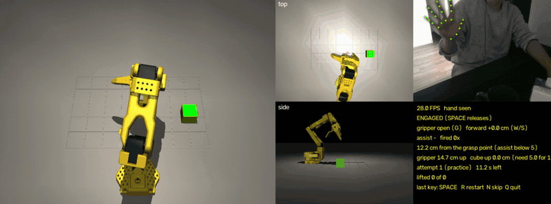
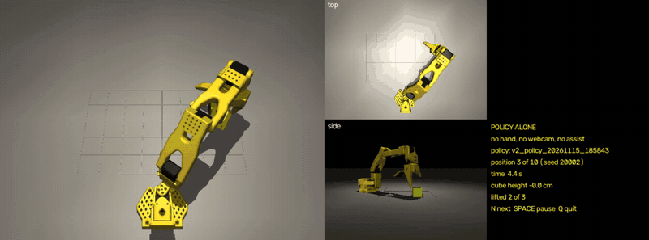
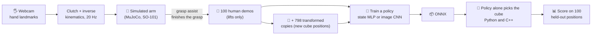

<div align="center">

# 🦾 webcam-teleop-imitation

**Teach a robot arm to pick up a cube by showing it your hand.**<br>
A webcam tracks one hand and drives a simulated SO-101 arm. The demos recorded that way train a policy that then
does the job by itself, from the cube's position or from a camera image, in Python and in C++.

[](https://github.com/ptchpmk0100/webcam-teleop-imitation/actions/workflows/tests.yml)


| 🖐️ **You teach it**: webcam hand → arm | 🤖 **It does it alone**: the learned policy |
|:---:|:---:|
| [](docs/media/teleop-demo.mp4) | [](docs/media/policy-demo.mp4) |
| Live webcam teleop: hand landmarks move the gripper, a grasp assist finishes the grasp. ([60 s video](docs/media/teleop-demo.mp4)) | The trained policy alone: no hand, no webcam, no assist. ([66 s video](docs/media/policy-demo.mp4)) |

**100 / 100** cube positions lifted on held-out positions by the state policy (3 of 3 training seeds) ·
**97 / 100** from the camera image alone · C++ rollout gives the same outcome on every position

</div>

## The idea

First **a human teaches**: hand tracking from an ordinary webcam steers the arm, and a grasp assist closes the last
centimetres. Every successful attempt is saved as a demonstration. Then **the robot learns to imitate**: a small
network is trained on those demos (plus copies moved to new cube positions) and takes over, with no human and no assist.



## Results

Success is always read from the simulator's state (cube bottom more than 5 cm above the table for 1 s), never from the
program's own status output. All scores are **policy alone** (no hand, no webcam, no grasp assist) on 100 held-out cube
positions the policy never saw.

### State policy (the cube pose is an input)

Three training seeds, all reported, none chosen.

| training set | seed 0 | seed 1 | seed 2 | mean | same policy in C++ |
|---|---|---|---|---|---|
| 100 human demos | 96/100 | 90/100 | 84/100 | 90.0 | equal on every position |
| 100 human demos + 798 transformed copies | **100/100** | **100/100** | **100/100** | **100.0** | equal on every position |

Next to it: the scripted expert lifts 100/100; a do-nothing policy and a random policy lift 0/100 (null checks, Python
and C++). All of these numbers, with 95 percent intervals, are printed by one command:

```
make final-scores HUMAN="RUN RUN RUN" COPIES="RUN RUN RUN"      # RUN = a folder with policy.onnx and run.json
```

### Image policy (a camera picture instead of the cube pose)

Same design and same rollout, but the network sees the 96x128 policy-camera image and the arm's own joints, never the
cube pose. Trained once (training seed 0) on the same demos + copies (97,179 frames, free Kaggle T4, 40 epochs,
20 minutes).

| set | lifted | 95% interval |
|---|---|---|
| 100 development cube positions | 97/100 | 0.92-0.99 |
| 100 held-out cube positions (scored once) | **97/100** | 0.92-0.99 |

```
python -m teleop_il.train_image_v2 score models/image_policy_v2 [--held-out]
```

### What these numbers do and do not say

- Of the 100 human demos, 80 are in training and 20 are the validation split. The copies in training are the 626
  made from those 80 demos (798 exist in total).
- The demos were recorded with a grasp assist: the human steers the approach and presses the gripper key near the
  cube, and the assist lines up, descends and closes. **The grasp segment of each demo is the assist's motion**, not
  the human's. The trained policies run without the assist.
- "Policy with assist" is a secondary number only (same command): 96, 87, 89 for the human-only state policies and
  100, 100, 100 with copies.
- Teleop baseline (human with grasp assist, counted live while recording, not recomputable because failed attempts
  were not saved): 30 of 30 attempts lifted, median 8.0 s (first 25 demos); 56 of 58, median 6.9 s (largest session).
- The image policy has one training seed, so it is not a spread over seeds like the state-policy table. There is no
  C++ port of it, and it is not in `make final-scores`.
- One cube on a table, in simulation. Nothing here was run on a real arm.
- The first policy design scored 0/100 on the same demos (absolute joint targets, short chunks). The re-design and
  its gates are in [docs/research/PRD-v2.md](docs/research/PRD-v2.md).

## What is in the repository

| folder | contents |
|---|---|
| [`models/`](models/) | the trained policies as ONNX and PyTorch weights, with their score files: 6 state policies, 1 image policy |
| [`datasets/`](datasets/) | the 100 cleaned human demos and the 798 transformed copies (simulator states only, no webcam images) |
| [`results/`](results/) | the raw output of `make final-scores` (Python and C++ outcomes per position) |
| [`docs/media/`](docs/media/) | the two videos and their preview GIFs |
| `src/teleop_il/` | teleop, simulator environment, demos, labels, training, evaluation, the C++ parity checks |
| `tests/` | 287 tests, run by CI on every push |
| [`docs/research/`](docs/research/) | design, decisions and the evidence for each step (start with `HANDOFF.md`) |

## Skills and technologies

| area | what this project shows |
|---|---|
| **Robot learning** | imitation learning, behavior cloning, learning from demonstration, visuomotor policy, action chunking with temporal ensembling (ACT-style), demonstration data augmentation, closed-loop policy evaluation |
| **Computer vision** | real-time hand tracking (MediaPipe), webcam teleoperation, CNN with spatial-softmax keypoints, image-based policy, rendered-image datasets |
| **Robotics** | MuJoCo simulation, SO-101 robot arm, pick-and-place manipulation, inverse kinematics (mink), end-effector control, grasp assist, teleoperation interface |
| **ML engineering** | PyTorch, ONNX export and ONNX Runtime inference, PyTorch/ONNX numerical parity checks, GPU training on Kaggle (Tesla T4), held-out evaluation with Wilson confidence intervals, null-policy sanity checks, reproducible seeds |
| **Software engineering** | Python 3.12, C++17, CMake, Python/C++ cross-language parity testing, pytest (287 tests), GitHub Actions CI, uv, Makefile workflow, Linux |

## How it works

1. **Teleop** (`make demo`): MediaPipe hand landmarks from the webcam move the gripper target; inverse kinematics
   turns it into joint targets at 20 Hz. A clutch key engages the hand; a grasp assist finishes the grasp.
2. **Demos** (`make demo ARGS=--record`): every attempt that lifts the cube without losing the hand for more than
   0.3 s is saved with the full simulator state. Demo cubes use seeds below 10000; the held-out positions are seeds
   10000-10099 and are scored only at named checkpoints; development seeds 20000-20099 are used for everything else.
3. **Labels** (`python -m teleop_il.convert build|gate`): the action is where the gripper actually went one step
   later, relative to where it is, plus open/closed. A gate replays every demo from its labels through the policy's
   own controller and counts lifts.
4. **Transformed copies** (`python -m teleop_il.transform DATA OUT`): each demo's gripper path is moved to a new cube
   position, replayed in the simulator, and kept only if the cube lifts (798 of 1000 tries).
5. **State policy** (`python -m teleop_il.train_v2 --data DIR [--extra COPIES]`): a small MLP on 6 cube-relative
   numbers predicts the next 20 gripper moves; the predictions of recent steps are blended (as in ACT) and a
   controller turns the target into joint targets. Trains on CPU in a few minutes and exports ONNX.
6. **Image policy** (`python -m teleop_il.train_image_v2 prepare|fit|score`): a small CNN with a spatial-softmax
   keypoint layer finds the cube in the camera image; same outputs and same rollout as the state policy. Training
   needs a GPU to be quick: `image_policy_v2.py` runs on its own with numpy and torch, which is how it ran on Kaggle.
7. **C++** (`make policy-v2-parity RUN=...`): the same ONNX state policy and controller in a C++ rollout with ONNX
   Runtime, checked against Python on every held-out position.

## Quick start

Linux, Python 3.12, [uv](https://docs.astral.sh/uv/), CMake and a C++ compiler. `make setup` (run by the other
targets) installs the environment and fetches the pinned SO-101 model (mujoco_menagerie), the MediaPipe hand model
and ONNX Runtime.

```
make test                                                     # all tests
make policy-demo RUN=models/state_policy_v2/copies_seed0      # watch the trained policy alone, live
make demo                                                     # teleop with your own hand (needs a webcam)
```

## Commands

- `make demo`: webcam teleop practice in one window. Light your hand, face the webcam. SPACE engages the clutch, then
  your hand moves the gripper left-right and up-down; W/S move it forward and back; G closes and opens the gripper.
  When the marker under the gripper turns green you are within 5 cm of the cube: press G and the grasp assist lines
  up, descends and closes, then hands back and you lift. R restarts, N skips, Q quits.
- `make demo ARGS=--record`: record demos into a new `runs/demos_<time>/`. `make trial`: 10 counted attempts.
- `make demo ARGS="--log runs/tryN.npz"` then `make diagnose LOG=runs/tryN.npz`: a session log and its summary.
- `python -m teleop_il.convert build OUT SESSION...` and `... gate DATA`: clean recorded sessions; the label gate.
- `python -m teleop_il.transform DATA OUT [--copies N]`: transformed copies.
- `python -m teleop_il.train_v2 --data DIR [--extra COPIES] [--seed S]`: train, export and score the state policy on
  the development seeds (`--held-out` only at a checkpoint); the null checks run in the same command.
- `python -m teleop_il.replay DATA OUT`, then `python -m teleop_il.train_image_v2 prepare|fit|score`: the image policy.
- `python -m teleop_il.breakdown RUN`: where a policy's failures happen.
- `make policy-demo RUN=...`: watch the policy alone, live.
- `make policy-v2-parity RUN=...`, `make parity`: C++ against Python (policy rollouts; physics).
- `make final-scores HUMAN="..." COPIES="..."`: the state-policy table above.
- `python -m teleop_il.evaluation`: the harness null checks.

Python commands run through `env -u PYTHONPATH uv run ...`. New recordings, training runs and renders go to `runs/`,
which is not in the repository; the demos and models above are the ones the reported numbers come from.
